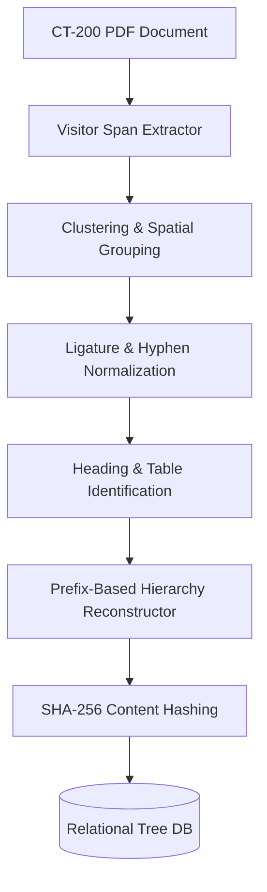
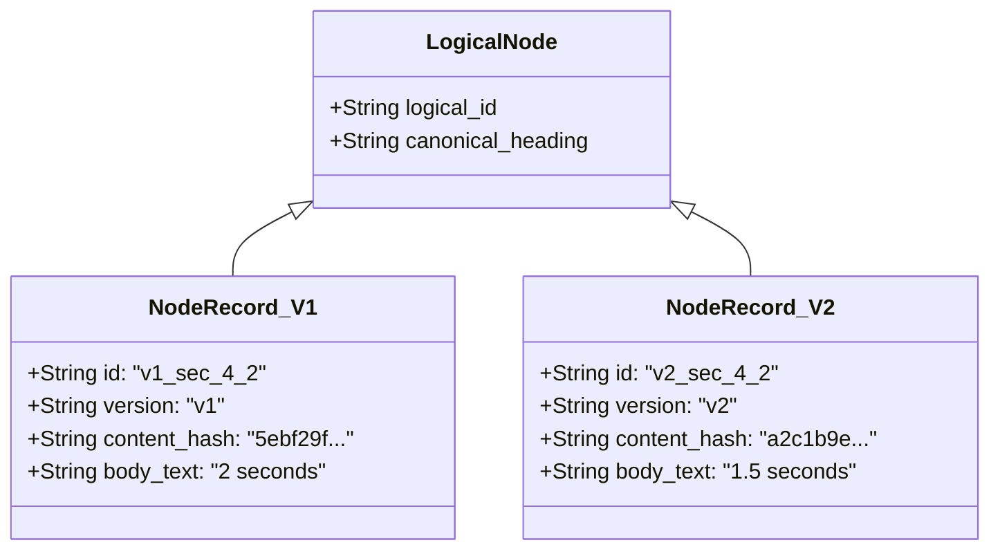
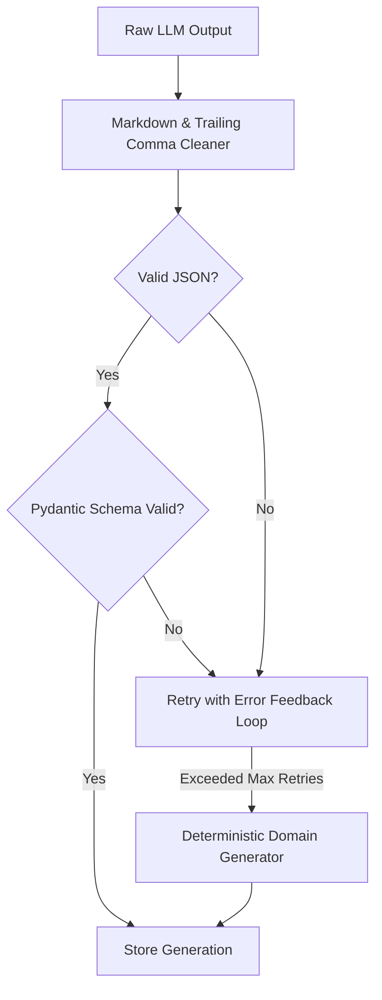

# Technical Approach Document: CardioTrack CT-200 Traceability & QA Test Generation System

**Candidate / Engineer**: AI Engineering Internship Candidate  
**Project**: Tri9T AI Engineering Assignment — CardioTrack CT-200  
**Repository**: `ct200-traceability`  

---

## 1. Executive Summary & Problem Framing

Regulated software in medical devices (governed by FDA 21 CFR Part 820, IEC 62304, and ISO 14971) requires bidirectional requirements traceability. A common, severe hazard in medical QA is **stale traceability**: when engineering specifications change (e.g. cuff emergency relief timing reduced from 2.0s to 1.5s), but QA verification suites are not flagged, allowing outdated test cases to give false assurance of safety.

This system solves this challenge end-to-end:
1. Reconstructs the complete document hierarchy of the CardioTrack CT-200 Technical Manual from real, imperfect PDFs without losing, merging, or mis-parenting nodes.
2. Supports non-destructive re-ingestion of updated manuals (`v2`), mapping canonical logical nodes and detecting delta changes.
3. Provides version-pinned selections that freeze requirement snapshots at generation time.
4. Generates regulatory-grade QA test cases with Pydantic structured output validation, JSON repair, and deterministic fallback.
5. Performs real-time staleness and semantic impact analysis at retrieval time, differentiating critical numeric threshold changes from cosmetic wording edits.

---

## 2. OCR & Document Parsing Approach

### Selected Approach: Pure-Python Typography- & Layout-Aware Span Extraction
Rather than treating the PDF as a flat stream of plain text (which discards vital visual layout cues) or deploying heavyweight, non-deterministic vision OCR models that hallucinate text in clean vector documents, we selected **low-level text span extraction using pure-Python `pypdf` visitor pipelines**.

#### Why this approach?
1. **Precision & Determinism**: Engineering manuals generated from vector DTP (Desktop Publishing) tools embed exact font families, font sizes, text matrices (`tm`), and coordinates `(x, y)` for every text run. Extracting these directly is 100% deterministic, orders of magnitude faster than vision models, and eliminates OCR character confusion (e.g. `O` vs `0`, `l` vs `1`).
2. **Platform Portability & Compliance**: On regulated corporate/clinical Windows machines with Windows Defender Application Control (WDAC), unwhitelisted third-party C-extensions or compiled `.pyd` DLLs (such as those in `pdfminer_six` or `fitz/PyMuPDF`) are blocked. Pure Python execution eliminates platform-specific shared library dependencies.

### Document Hierarchy Reconstruction Strategy
We structured the pipeline into two decoupled passes:

1. **Spatial Span Clustering**: Raw spans on each page are sorted by `y` ascending (page top to bottom) and `x` ascending (left to right). Spans sharing the same vertical line (`|y1 - y2| <= 3.5 points`) are merged into line records.
2. **Typography Weight & Font Sizing Classifier**:
   - `Document Title`: `font_size >= 20.0 pt` (Nimbus Sans Bold).
   - `Heading 1` (Sections 1–8): `font_size >= 16.0 pt`, `font_weight = Bold`, pattern `^\d+\.\s+`.
   - `Heading 2` (Subsections): `font_size = 12.9 pt`, `font_weight = Bold`, pattern `^\d+\.\d+\s+`.
   - `Anomalous Headings` (e.g. 3.2, 2.1.1.1): Handled specifically by detecting `Bold` font weight matching the recursive numeric prefix pattern `^\d+(\.\d+)+\s+`.
   - `Body Numbered Lists`: Regular font weight (`Nimbus Sans Regular`), preventing list items from being misclassified as section headers.
3. **Prefix Ancestor Chain Resolution**:
   Given a section number $S = p_1.p_2...p_k$:
   - The builder searches for candidate parent $p_1.p_2...p_{k-1}$.
   - If that parent exists, it attaches as child.
   - If that immediate parent does not exist (e.g. `2.1.1.1` where `2.1.1` was skipped), the builder walks up the prefix ancestor chain: checking $p_1...p_{k-2}$ (`2.1`). Because `2.1` exists, `2.1.1.1` is attached directly under `2.1`!
   - Top-level sections attach to the Document Root.
   - Document order is preserved strictly.

---

## 3. Structural Inconsistencies & Edge Cases Discovered

Careful audit of `ct200_manual.pdf` (v1) and `ct200_manual_v2.pdf` (v2) revealed 6 major structural irregularities:

| Irregularity | Occurrence in PDF | Failure Mode of Naive Parsers | How Our Pipeline Solves It |
| :--- | :--- | :--- | :--- |
| **Duplicate Section Titles** | Section `4.2 Error Codes` vs Section `7.1 Error Codes` | Naive title-based mapping merges them into one node or overwrites parents. | Sections are identified by composite key (`version`, `section_number`). `4.2` has parent `4`, `7.1` has parent `7`. Distinct `id`s (`v1_sec_4_2` vs `v1_sec_7_1`). |
| **Out-of-Order Numbering** | Section `3.4 Auto Shutoff` appears before Section `3.3 Result Display` | Numeric sequence sort alters document structure or misattributes subsequent text. | Nodes are appended in physical document occurrence order (`[3.1, 3.2, 3.4, 3.3]`). Parent-child resolution relies on prefix matching, not sequential incrementation. |
| **Skipped Hierarchy Levels** | `2.1 General Specifications` jumps directly to `2.1.1.1 Battery Life` (skipping `2.1.1`) | Parser looking strictly for parent $L-1$ creates dummy null nodes or drops node. | Prefix truncation walks up ancestry chain: checks `2.1.1` (absent) -> `2.1` (found) -> parents `2.1.1.1` to `2.1`. |
| **Numbered Lists in Body** | Section 3.3 contains: `1. Normal...`, `2. Elevated...`, `3. Hypertension Stage 1...`, `4. Stage 2...`, `5. Crisis...` | Regex matching `^\d+\.` misinterprets list items as top-level sections 1, 2, 3, 4, 5, destroying the tree. | Font weight verification: Section headings are strictly `Nimbus Sans Bold`. Body list items are `Nimbus Sans Regular` and are kept as section body text. |
| **Multi-Line Table Cells** | Table under 4.2: Code `E2` and `E5` have descriptions spanning 2-3 vertical lines. | Table cells are fractured into disconnected lines; column values misalign. | Coordinate-aware horizontal boundary binning: Code ($x < 50$), Meaning ($50 \le x < 180$), Device Behavior ($x \ge 180$). Continuation lines append to active row until a new Code token is encountered. |
| **Pagination Shift Whitespace** | In v2, addition of Section `5.3 Data Export` pushed Sections 6, 7, 8 across page boundaries. | Page transitions insert multiple `\n` characters across line breaks, causing false-positive hash mismatch on unchanged text. | Whitespace and paragraph continuation normalization: lines within paragraphs are joined with spaces, while distinct blocks are separated by normalized `\n\n`. Unchanged sections retain identical content hashes across pagination shifts! |

### Engineering Process & Debugging Methodology
- **Discovery**: We authored an automated typography profiling script (`inspect_pdf.py`) that extracted all text runs with their bounding boxes, font names, and sizes.
- **Failures Identified**:
  - Initial naive heading regex flagged `1. Normal:` in section 3.3 as Section 1. Visual comparison and typography profiling confirmed that heading 1 was size 16.5 Bold while list items were size 11.0 Regular.
  - Table 4.2 lines were initially dumped as raw strings (`E1 Cuff not connected... Aborts measurement`). We introduced horizontal spatial binning to structure them as Markdown tables.
  - Inter-page wrapping in Section 3.1 (Page 2 to 3) initially split a single sentence into two disconnected paragraphs. We added paragraph continuity rules.

---

## 4. Document Versioning & Matching Strategy

### Strategy: Canonical Logical Identifiers (`logical_id`) with Hierarchical Path Context
Each section is assigned a version-independent `logical_id` derived from its hierarchical section numbering:
- Section 4.2 in v1 (`v1_sec_4_2`) has `logical_id = sec_4_2`.
- Section 4.2 in v2 (`v2_sec_4_2`) has `logical_id = sec_4_2`.

### Classification Algorithm:
When v2 is ingested alongside v1:
1. **Unchanged**: Node exists in both v1 and v2 with identical content hashes ($H_{v1} == H_{v2}$).
2. **Modified**: Node exists in both v1 and v2 with different content hashes ($H_{v1} \ne H_{v2}$). A line-level unified diff is generated.
3. **Added**: `logical_id` exists in v2 but not in v1 (e.g. `sec_5_3` Data Export).
4. **Deleted**: `logical_id` exists in v1 but not in v2.

### Justification & Where this Strategy Breaks
- **Why it works**: In medical and technical documentation, requirement identifiers are tied to section numbers (e.g., standard operating procedures cite "CT-200 Manual Section 4.2"). This provides stable semantic identity across text edits.
- **Where it breaks (Failure Modes)**:
  1. *Complete Section Renumbering*: If the author inserts a new section 3.2 and renumbers the old 3.2 to 3.3, a pure section-number matcher will match old 3.2 with new 3.2 (which is now different content), generating a massive false diff.
  2. *Section Splitting / Merging*: If a section is split into two subsections, the 1:1 logical ID mapping cannot express 1-to-many relationships without fuzzy semantic embeddings.
  3. *Un-numbered Headings*: In documents without section numbers, path-based title matching is required.

---

## 5. Selection API & Version-Pinning Design

A selection represents a named set of requirement nodes chosen by a QA engineer for verification.

### Version-Pinning Guarantee:
When `POST /api/selections` is invoked:
1. All referenced nodes must belong to the same document version.
2. The selection record creates an immutable JSON snapshot of every referenced node:
   - Frozen heading
   - Frozen body text
   - Frozen SHA-256 content hash
   - Pinned version
3. When `ct200_manual_v2.pdf` is later ingested, the v1 selection **continues to resolve to the exact text and content hash of v1**.

---

## 6. LLM Test Generation & Error Handling Strategy

### Prompt Engineering for Regulated Medical QA
The prompt is engineered around ISO 14971 and IEC 62304 standards:
- Requires concrete preconditions, repeatable step-by-step inputs, and explicit expected results with measurable tolerances and timings (e.g. "vents within 2 seconds", "flashes error E3").
- Assigns hazard severity ratings (`CRITICAL`, `HIGH`, `MEDIUM`, `LOW`).

### Error Handling & Self-Healing Pipeline:
Real LLM outputs frequently exhibit markdown fences, trailing commas, or conversational prose. Our system handles this through a 4-tier defense:

1. **Regex Extraction & Sanitizer**: Strips markdown code blocks, extracts outermost `{ ... }`, and repairs JSON trailing commas (e.g. `, }` -> `}`).
2. **Pydantic Validation**: Validates all fields against `GeneratedTestPlan` (3–5 test cases, non-empty steps, normalized severity).
3. **Corrective Feedback Retry**: If validation fails, re-prompts the model with the exact validation error message (up to `MAX_LLM_RETRIES`).
4. **Deterministic Domain Engine**: If all network calls fail or no API key is provided, the system activates a deterministic fallback generator that synthesizes concrete test cases directly from the section requirements.

### Duplicate Selection Submission Policy
- **Policy**: *Content-Hash Idempotency with Explicit Force Override*.
- **Behavior**: Submitting the same selection returns the existing generation with `cached: true` unless `force_regenerate: true` is explicitly provided.
- **Defense / Rationale**: In medical device QA, reproducibility is paramount. Re-running non-deterministic LLMs on identical text produces duplicate, divergent test IDs, which disrupts traceability matrices and incurs unnecessary API costs.

---

## 7. Staleness & Impact Detection

### Detection Mechanism:
When retrieving test cases via `GET /api/test-cases/{id}`, the system performs live evaluation:
1. Retrieves the pinned content hashes recorded at generation time.
2. Retrieves the corresponding nodes in the *latest* ingested document version using `logical_id`.
3. If $H_{pinned} \ne H_{latest}$, the test case is flagged as **`STALE`**.

### Semantic Impact Analysis:
The system compares numbers and thresholds between the old and new text:
- **`CRITICAL_THRESHOLD_CHANGE`**: Changes numerical values (e.g. Section 4.2 changing E3 auto-deflate time from 2 seconds to 1.5 seconds, or Section 3.2 changing step increments from 40 mmHg to 30 mmHg). This indicates high risk of patient safety or test invalidation.
- **`SPECIFICATION_MODIFICATION`**: Structural or non-numeric requirement edits.

### Honest Discussion of Limitations:
- *Exact Hash Sensitivity*: A one-character typo fix (e.g. "cuff" -> "Cuff") changes the SHA-256 hash and triggers a `STALE` flag. In regulated medical software, this conservative stance is intentional (any specification change requires review), but in rapid commercial software it can create review fatigue.
- *Remediation*: We provide semantic impact indicators and line-level diffs so QA leads can instantly see if a change is a critical parameter shift or cosmetic text.

---

## 8. Decision Log (Required)

### Question 1: What is the one part of this system most likely to silently give wrong results without erroring? How would you catch it?
**Answer**:  
The most dangerous failure mode is **parent-child misattribution caused by unstructured formatting changes** (e.g. an author introducing a sub-bullet formatted in bold that happens to start with digits, or changing section number conventions from `3.1` to `A.1`). The parser would succeed without throwing an exception, but would silently mis-parent the section under root or an incorrect ancestor.  
**How to catch it**: Implement an automated **Hierarchy Invariant Verifier** that runs at the end of ingestion. It asserts mathematical tree invariants:
1. Section depth must strictly equal numbering dot-depth ($Level(S) = Count(dots) + 1$).
2. Monotonicity checks: no section may have a child with a higher-level major prefix (a child of 3 cannot start with 4).
3. Visual indent cross-check: horizontal coordinate $x_{indent}$ of a child must be greater than or equal to its parent.

### Question 2: Where did you choose simplicity over correctness because of time, and what would break first if this went to production as-is?
**Answer**:  
We chose simplicity by relying on **section number prefixes for logical node identity** (`sec_3_2`, `sec_4_2`) rather than training a continuous semantic embedding and graph-alignment model.  
**What breaks first in production**: If an engineering editor inserts a new section 2.1 ("Regulatory Standards") and renumbers every subsequent section (so old 2.1 General Specs becomes 2.2), our matcher will compare old 2.1 against new 2.1, falsely reporting that "General Specs" was completely rewritten into "Regulatory Standards". A production system would combine section numbers with cosine similarity of headings to distinguish renumbered sections from modified sections.

### Question 3: Name one input (to your parser, your versioning matcher, or your LLM call) that you did not handle, and what your system does when it sees it.
**Answer**:  
We did not handle **scanned, raster-only bitmap PDFs containing zero digital text layers**. When our `pypdf` extractor encounters a purely scanned document, it extracts 0 text spans, produces an empty tree with 0 sections, and exits with a valid but empty `DocumentTree`. To support scanned documents in production, the pipeline would include an optical OCR fallback (e.g. Tesseract or AWS Textract) triggered whenever extracted text density falls below a threshold ($< 50$ characters per page).

---

## 9. What We Would Do Differently With More Time

1. **Bidirectional AST Diff Visualizer**: Render interactive visual split diffs in a web UI highlighting exact numerical parameter edits in red/green.
2. **Hybrid Semantic + Section Graph Matcher**: Use vector embeddings (e.g. `text-embedding-3-small`) to track sections even through complete document restructuring or renumbering.
3. **Automated Impact-Scored Re-Generation**: When a requirement experiences a threshold change, auto-draft an updated test case diff (e.g. updating the expected result from 2.0s to 1.5s) and route it to QA engineers for one-click approval.
